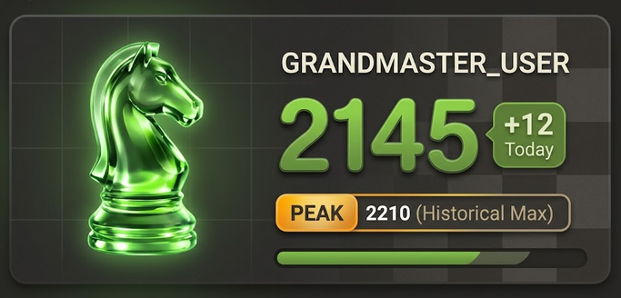

# ChessRank Widget ♟️✨

[](https://github.com/iMasry-Git/ChessRank-Widget/releases/latest)
[](https://github.com/iMasry-Git/ChessRank-Widget)
[](LICENSE)

A modern, native Windows 11 Desktop Widget for [Chess.com](https://www.chess.com) that sits quietly on your desktop wallpaper. It tracks your live rating, daily rating gains or losses, historical peak rank, and visual progress toward your next rating milestone.

---

## 📸 Preview

<p align="center">
  
</p>

---

## ✨ Features

- **True Desktop Widget Experience**:
  - Pinned directly to the Windows desktop wallpaper (`HWND_BOTTOM`).
  - Does **not** minimize when pressing `Win + D` (*Show Desktop*).
  - No taskbar button and hidden from `Alt + Tab` to keep your workspace clutter-free.
  - Sits quietly in the Windows System Tray (`NotifyIcon`).

- **Live Chess.com Integration**:
  - Real-time rating sync for **Rapid**, **Blitz**, **Bullet**, or **Daily** time controls.
  - Respects your profile's exact casing (capital and lowercase letters, e.g. `iMasryi`).
  - Computes actual rating change (**+ / − Today**) since local midnight from rated game archives.
  - Highlights your all-time highest rating (**PEAK Historical Max**).

- **Visual Goal Progression**:
  - Dynamic gradient progress bar tracking how close you are to your rating target.
  - Clear countdown label (e.g. `120 to go` or `Goal reached`).
  - Configurable target and baseline rating.

- **Polished Windows 11 Design**:
  - Smooth 22px curved corners (*squircle*) with subtle chessboard grid overlay.
  - High-resolution crystal emerald knight avatar.
  - Configurable sizing from **25%** to **125%** (default 90% = `378px × 171px`).
  - Configurable window opacity (**60% – 100%**) and draggable placement with position lock.
  - Optional sound alerts on rating gains and goal achievements.

---

## 🚀 Quick Start / Download

### 1. Download
Grab the latest release from the [**Releases Page**](https://github.com/iMasry-Git/ChessRank-Widget/releases/latest):
- **`ChessRankWidget.exe`** — Single portable executable. No installer or runtime setup needed.
- **`ChessRank-Widget-v3.1.0.zip`** — Complete portable distribution package with source, batch scripts, and icons.

### 2. Run
1. Double-click `ChessRankWidget.exe`.
2. Right-click the widget (or its System Tray icon) and select **Settings…**.
3. Enter your **Chess.com username**, choose your **Rating type** (Rapid, Blitz, Bullet, Daily), set your **Target rating**, and click **Save**.
4. Drag the widget to your favorite spot on the desktop, then right-click and check **Lock position**.

---

## 🛠️ Configuration Options

| Setting | Description | Default |
|---|---|---|
| **Chess.com Username** | Your Chess.com account handle | `GRANDMASTER_USER` (Demo) |
| **Rating Type** | Rapid, Blitz, Bullet, or Daily | `Rapid` |
| **Auto-Refresh** | 1m, 5m, 15m, 30m, 1 hour, or Manual | `30 minutes` |
| **Target Rating** | Your rating milestone goal | `2200` |
| **Baseline Rating** | Where the progress bar starts (blank = auto) | `Auto` |
| **Widget Size** | Scale from 25% (micro) to 125% (large) | `90% (378×171)` |
| **Opacity** | Widget transparency level (60% to 100%) | `100%` |
| **Placement Layer** | Pinned to desktop, Always on top, or Normal window | `Pinned to desktop` |
| **Start with Windows** | Automatically launches at user login | Optional |
| **Sound Alerts** | Plays pleasant chime when rating increases | `Enabled` |

---

## 🏗️ Building from Source

No heavy IDE or external SDK is required! You can compile `ChessRankWidget.exe` using the C# compiler already bundled with Windows:

```cmd
build.bat
```

This compiles `ChessRankWidget.cs` against .NET Framework 4.x with full async networking, Win32 interop, and WPF vector layout.

---

## 🌐 Browser Extension Mode

The project also includes a ready-to-load Chrome / Edge browser extension:
1. Open `chrome://extensions` or `edge://extensions`.
2. Enable **Developer mode**.
3. Click **Load unpacked** and select this directory.

---

## 📄 License

This project is licensed under the [MIT License](LICENSE).
